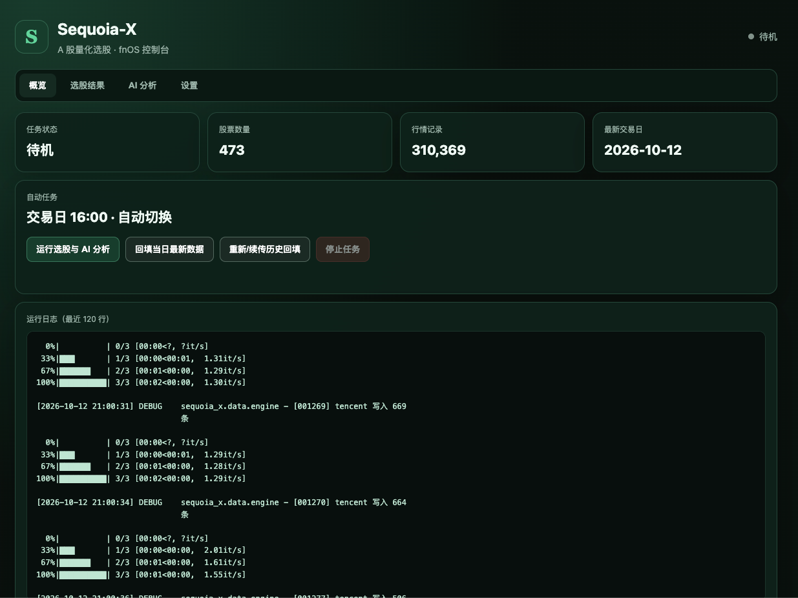
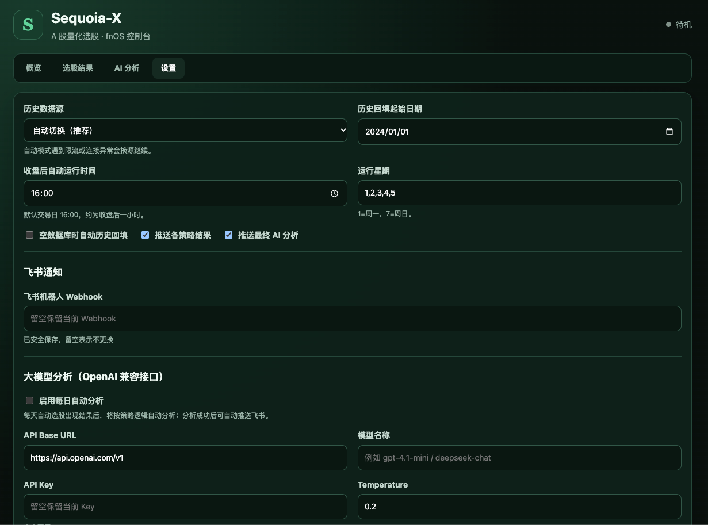

# Sequoia-X: 王者回归 | The King Returns

> A 股量化选股系统 V2 | A-Share Quantitative Stock Selection System V2

> [!IMPORTANT]
> 本仓库是基于原作者 [sngyai/Sequoia-X](https://github.com/sngyai/Sequoia-X) 的社区二次开发版本，
> 主要增加飞牛 fnOS 原生应用、Web 管理控制台、多行情源故障转移和大模型分析能力。
> 本仓库不是原作者发布或维护的官方 fnOS 版本；原始代码及项目名称相关权利归原作者和相应贡献者所有。
> GitHub 的 Fork 关系用于保留完整上游来源和提交历史。

---

## 简介 | Introduction

Sequoia-X V2 是面向 A 股市场的量化选股系统，基于现代 Python 工程化标准从零重构。
系统以 OOP 架构、向量化计算和增量数据更新为核心设计原则，每日收盘后自动选股并推送至飞书群。

数据层支持东方财富、腾讯、新浪与 Baostock，并可在连接异常、超时或限流时自动换源；
行情存储于本地 SQLite。fnOS Web 控制台可展示策略结果，并通过 OpenAI 兼容接口生成二次分析。

---

## 三种运行模式

```bash
python main.py               # 同步最新行情 + 运行策略 + AI 分析 + 飞书推送
python main.py --backfill    # 全市场历史 K 线回填/续传
python main.py --update-only # 仅回填当日最新行情
```

## 飞牛 fnOS 应用

项目已提供原生 Python FPK，可通过飞牛应用中心手动安装，无需 Docker。管理页包含概览、选股结果、AI 分析和设置，可管理数据源、回填日期、定时任务、飞书 Webhook，以及 OpenAI 兼容大模型的 Base URL、模型和 API Key。SQLite 数据、结果历史、配置和日志均持久化保存。

### Web 控制台预览

概览页：查看任务状态、行情数据统计、运行日志，并可手动执行选股、当日更新和历史回填。



设置页：管理数据源、自动运行时间、飞书通知和 OpenAI 兼容大模型。



```bash
./fnos/build-fpk.sh
```

构建前需要安装飞牛官方 `fnpack` 1.2.3、`uv` 和 Python 3.12。脚本会生成内置 Linux x86_64 依赖的原生安装包。详细说明见 [`fnos/README.md`](fnos/README.md)。

预编译安装包请从 [GitHub Releases](https://github.com/HarmonyRun/Sequoia-X-fnOS/releases) 下载。当前仅提供
x86_64 版本，安装时请在飞牛应用中心启用“手动安装应用”，上传 `.fpk` 文件。

## 上游关系与二次开发声明

- **上游项目：** [sngyai/Sequoia-X](https://github.com/sngyai/Sequoia-X)
- **本仓库维护者：** [HarmonyRun](https://github.com/HarmonyRun)
- **关系：** 本仓库通过 GitHub Fork 从上游派生，并保留上游 Git 历史；不是独立冒充的原始项目。
- **上游同步：** `upstream` 远程用于跟踪原作者后续更新，二次开发内容发布在本仓库。
- **责任边界：** fnOS 安装包、Web 控制台、数据源切换及大模型功能由本仓库维护者提供，相关问题请在本仓库反馈，不要要求原作者为这些新增功能提供支持。

上游 README 当前将项目标注为 MIT License，但上游仓库没有提供独立的 `LICENSE` 文件。本仓库不扩大、替换或重新解释上游授权；使用、分发原始代码及二次开发内容时，请同时核对上游最新版权与许可声明。

### 本分支的主要新增功能

- 飞牛 fnOS x86_64 原生 FPK，无需 Docker
- 概览、选股结果、AI 分析和设置 Web 控制台
- 东方财富、腾讯、新浪、Baostock 多数据源及自动故障转移
- 历史数据续传回填、当日数据手动更新、交易日定时任务
- OpenAI 兼容大模型按策略逻辑自动分析选股结果
- 策略结果和最终 AI 分析自动推送飞书
- API Key、Webhook 和管理密码私有持久化，不通过管理 API 回显

---

## 内置策略 | Strategies

| 策略 | 说明 |
|---|---|
| **TurtleTrade** | 海龟突破：20日新高 + 成交额过亿 + 阳线防诱多，按涨幅排序 |
| **MaVolume** | 均线+放量突破 |
| **HighTightFlag** | 高而窄的旗形整理突破 |
| **LimitUpShakeout** | 涨停洗盘回踩确认 |
| **UptrendLimitDown** | 上升趋势中的跌停反包 |
| **RpsBreakout** | 欧奈尔 RPS 相对强度突破 |

---

## 快速开始 | Quick Start

### 环境要求

- Python >= 3.10

### 1. 安装依赖

```bash
# 推荐使用 uv（快速包管理器）
uv sync

# 或者 pip
pip install .
```

### 2. 配置环境变量

```bash
cp .env.example .env
# 编辑 .env，填写飞书 Webhook URL
```

### 3. 首次回填历史数据

```bash
python main.py --backfill
```

约 12 分钟完成 ~5200 只 A 股历史后复权日 K 数据回填。

### 4. 日常运行

```bash
python main.py
```

建议配合 crontab 每个交易日收盘后自动执行：

```cron
15 19 * * 1-5 cd /root/Sequoia-X && .venv/bin/python main.py >> log.txt 2>&1
```

---

## 目录结构 | Project Structure

```
Sequoia-X/
├── main.py                      # 入口：argparse 分发日常/回填模式
├── pyproject.toml               # 依赖声明 + ruff/pytest 配置
├── .env.example                 # 环境变量模板
├── data/                        # SQLite 数据库（运行时生成，不入 git）
├── sequoia_x/
│   ├── core/
│   │   ├── config.py            # Pydantic-settings 配置管理
│   │   └── logger.py            # rich 结构化日志
│   ├── data/
│   │   └── engine.py            # 数据引擎（baostock 回填 + 增量同步 + SQLite）
│   ├── strategy/
│   │   ├── base.py              # 策略抽象基类
│   │   ├── turtle_trade.py      # 海龟交易策略
│   │   ├── ma_volume.py         # 均线放量策略
│   │   ├── high_tight_flag.py   # 高窄旗形策略
│   │   ├── limit_up_shakeout.py # 涨停洗盘策略
│   │   ├── uptrend_limit_down.py # 上升跌停策略
│   │   └── rps_breakout.py      # RPS 突破策略
│   └── notify/
│       └── feishu.py            # 飞书 Webhook 推送
└── tests/                       # 属性测试（hypothesis）
```

---

## 数据说明

- **数据源**：东方财富、腾讯证券、新浪财经、Baostock，支持自动故障转移
- **复权方式**：后复权（hfq）— 历史价格不变，适合增量存储，避免除权导致数据错乱
- **存储**：本地 SQLite（`data/sequoia_v2.db`），可直接拷贝到其他机器使用
- **自动更新**：默认每个交易日 16:00 执行，可在 Web 控制台修改

---

## 许可证 | License

MIT
